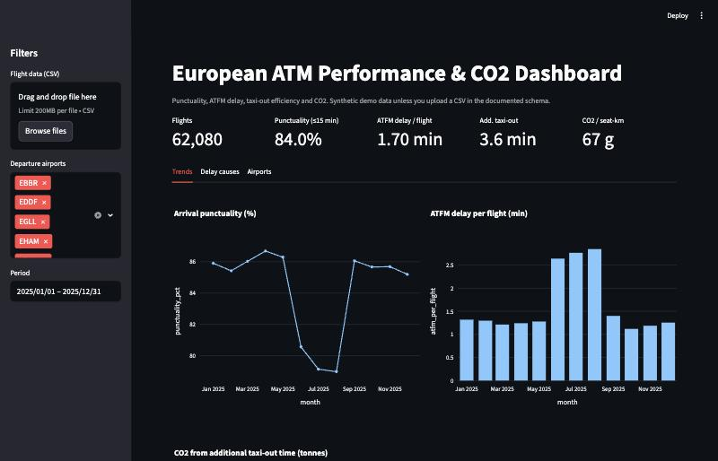
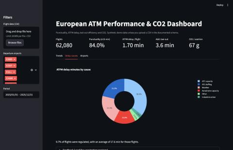

# European ATM Performance & CO2 Dashboard

**🌐 Live dashboard, runs in the browser: https://ferihabircan.github.io/atm-performance-dashboard/**

Interactive Streamlit dashboard that tracks the key performance indicators used
in European air traffic management reporting, and links operational
inefficiency to its environmental cost:

- **Arrival punctuality** (share of flights within 15 minutes of schedule)
- **ATFM delay per flight**, share of regulated flights, and **delay by cause**
  (ATC capacity, staffing, weather, aerodrome capacity, industrial action)
- **Additional taxi-out time** (actual minus unimpeded taxi time)
- **CO2 emissions** per flight and per seat-km, plus the CO2 caused by
  additional taxi-out time



## Features

- Filters by departure airport and period; KPI tiles update instantly.
- Monthly trends: the summer peak shows the familiar drop in punctuality and
  rise in ATFM delay driven by capacity and weather regulations.
- Delay-cause breakdown and an airport map / ranking table with CSV export.
- Upload your own flight CSV in the documented schema (e.g. built from the
  [EUROCONTROL Aviation Intelligence Portal](https://ansperformance.eu/) open
  datasets) instead of the synthetic demo data.
- Built-in feedback box, used to collect comments in user-testing sessions.
- A static web version (GitHub Pages) that filters airports and months in the
  browser from additive monthly aggregates. `kpis.aggregate` produces them and a
  unit test checks that the KPIs rebuilt from aggregates equal the raw ones exactly.



## Demo data results (62,080 flights, 10 airports, 2025)

| KPI | Value |
|---|---|
| Arrival punctuality | 84.0% |
| ATFM delay per flight | 1.70 min |
| Regulated flights | 9.7% (avg 17.6 min) |
| Additional taxi-out | 3.6 min |
| CO2 intensity | 67 g / seat-km |

## CO2 method

`fuel = LTO fuel + cruise fuel per km × distance + taxi fuel flow × additional taxi minutes`,
`CO2 = 3.16 × fuel` (ICAO factor). Fuel coefficients per aircraft type are
indicative values chosen for illustration; a production version should use
the ICAO Carbon Emissions Calculator methodology or EUROCONTROL's
emission models.

## Usage

```bash
python -m venv .venv && source .venv/bin/activate
pip install -r requirements.txt
streamlit run app.py
PYTHONPATH=src pytest -q
PYTHONPATH=src python scripts/export_site_data.py   # refresh docs/ website data
```

## Data schema

`flight_id, date, adep, ades, aircraft_type, seats, distance_km,
atfm_delay_min, atfm_cause, taxi_out_min, unimpeded_taxi_min, arr_delay_min`

## Project structure

```
app.py              Streamlit UI (filters, KPI tiles, charts, map, export)
src/atm_kpi/
  data.py           synthetic data generator and CSV loader with validation
  kpis.py           KPI and CO2 calculations (pure functions, unit tested)
scripts/            export_site_data.py: aggregates for the web dashboard
docs/               static web dashboard (GitHub Pages)
tests/              pytest suite with hand-checked KPI values
```

KPI logic is kept out of the UI so it can be tested and reused in reports.
